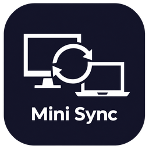

<p align="center">
  
</p>

<h1 align="center">Mini Sync</h1>

<p align="center">
  Keep a folder in sync between your own computers on the same network.<br>
  Windows &amp; macOS · one small program · no account, no cloud, no browser.
</p>

<p align="center">
  <a href="https://github.com/mk-manishkandel/MiniSync/releases/latest/download/minisync-windows-x64.exe"><b>⬇ Download for Windows</b></a>
  &nbsp;·&nbsp;
  <a href="https://github.com/mk-manishkandel/MiniSync/releases/latest/download/minisync-macos-arm64"><b>⬇ Mac (Apple chip)</b></a>
  &nbsp;·&nbsp;
  <a href="https://github.com/mk-manishkandel/MiniSync/releases/latest/download/minisync-macos-x64"><b>⬇ Mac (Intel)</b></a>
</p>

<p align="center">
  <a href="https://github.com/mk-manishkandel/MiniSync/releases/latest"></a>
  <a href="https://github.com/mk-manishkandel/MiniSync/releases"></a>
</p>

---

Mini Sync is a small, personal take on [Syncthing](https://syncthing.net/): put files in the
`MiniSync` folder on one computer and they appear on your other computers. It's written from
scratch in Rust and keeps only what's needed for syncing between your own devices.

## Features

- **Two-way sync** of one or more folders between any number of your devices
- **You choose who gets what:** share each folder with only the devices you pick, each with
  **read & write** or **read only** access
- **Encrypted, trusted-only connections.** Each device has its own key, and devices only talk to IDs you added
- **Finds your devices automatically** on the local network (or use a fixed IP)
- **Runs in the background** with a tray / menu-bar icon, and starts at login
- **Safe by default:**
  - deleted or overwritten files go to `.minisync-trash`
  - edits made on both sides keep both copies (`*.sync-conflict-*`)
  - every download is checked by hash before it replaces anything
- **Automatic updates** from GitHub Releases, cryptographically signed
- Small (~4 MB) and light (~10 MB of memory)

## Download

Click the link for your computer. It always downloads the newest version:

| Computer | Download |
|---|---|
| Windows 10/11 (64-bit) | **[minisync-windows-x64.exe](https://github.com/mk-manishkandel/MiniSync/releases/latest/download/minisync-windows-x64.exe)** |
| Mac with Apple chip (M1/M2/M3/M4) | **[minisync-macos-arm64](https://github.com/mk-manishkandel/MiniSync/releases/latest/download/minisync-macos-arm64)** |
| Mac with Intel chip | **[minisync-macos-x64](https://github.com/mk-manishkandel/MiniSync/releases/latest/download/minisync-macos-x64)** |

That one file is the whole app: no installer needed. Open it and the setup starts (see [Set up](#set-up-on-every-device)).

Not sure which Mac you have? Apple menu → **About This Mac**: *Chip: Apple M…* means Apple chip,
*Processor: Intel…* means Intel.

Older versions, signatures (`.sig`) and checksums (`SHA256SUMS.txt`) are on the
[Releases page](https://github.com/mk-manishkandel/MiniSync/releases).

<details>
<summary><b>Windows says "Windows protected your PC"</b></summary>

The app isn't code-signed with a paid certificate, so the first time you open a downloaded copy
Windows SmartScreen warns you. Click **More info → Run anyway**. Updates installed by the
app itself don't show this warning.
</details>

<details>
<summary><b>Mac says the app "cannot be opened"</b></summary>

Open Terminal in the folder where you downloaded it and run (use your file's name):

```sh
chmod +x minisync-macos-arm64
xattr -d com.apple.quarantine minisync-macos-arm64
./minisync-macos-arm64
```
After the first setup, Mini Sync installs itself and updates on its own.
</details>

## Set up (on every device)

Do this with both computers on the same Wi-Fi.

1. **Open the downloaded file.** The setup window asks for a **name** for this device
   (e.g. `office-pc`, `macbook`).
2. It shows **this device's ID** (already copied to the clipboard).
3. It asks for the **other device's ID**. Paste it and give that device a name.
   Send IDs to yourself (email, chat, notes) to copy them between computers.
4. It asks about a **folder**:
   - on your **first** device: *Create a folder* (Enter = the `MiniSync` folder in your home folder),
     then choose what the other device may do: **read & write** or **read only**
   - on your **other** devices: *Join a folder*. You'll get an invitation (see below)
5. **Allow network access** when asked:
   - Windows: firewall prompt → *Allow*
   - Mac: *Local Network* → *Allow*
6. Done. It installs itself, runs in the background and starts at every login.
7. On the joining device, once both are connected: the header shows **✉ 1 folder invitation**.
   Open the menu → **6 Invitations** → *Accept* → choose where to keep it.

Each device must have **the other device's ID**. To check: the tray icon should say
**"connected to …"**. Put a file in `MiniSync` and it shows up on the other device within seconds.

## Sharing and permissions

Every folder has an **owner**: the device that added it. Only the owner decides which devices get
the folder and what they may do:

| Access | The device… |
|---|---|
| **Read & write** | gets the files, and its changes are synced back to everyone |
| **Read only** | gets the files, but changes made there are **undone** (the edited copy is kept in its `.minisync-trash`) |
| **No access** | doesn't get the folder at all (the default for new devices and folders) |

- **Share or change access:** menu → **5 Share a folder / access** → pick a device → pick its access.
  The device gets an invitation the first time; later changes apply as soon as it reconnects.
- **Invitations:** menu → **6**. Accept (choose a location) or decline. Nothing is synced until you accept.
- **Taking access away** stops syncing on that device. Its copy of the files is kept.
- Devices sync a shared folder **through its owner**, so the owner must be on for changes to
  travel between the other devices. This keeps the owner's rules enforced: a read-only device can't
  slip changes in through another device.
- Different devices can share different folders: e.g. *Work* with your laptop only, and *Photos*
  read-only with a family computer.

Upgrading from v0.2: existing folders stay shared read & write with the devices you already had.
All devices need v0.3.0 or newer to talk to each other (they update automatically).

## Everyday use

Just use the `MiniSync` folder. Changes sync whenever the devices are on the same network.
If one is away, changes wait and sync when it's back.

**Tray icon** (Windows: by the clock, maybe under **^**; Mac: top menu bar):

| Item | What it does |
|---|---|
| *Mini Sync - connected to …* | Status |
| *Check for updates* / *Install update vX* | See [Updates](#updates) |
| *Open Mini Sync…* | Opens the menu below |
| *Open synced folder* · *View log* | Shortcuts |
| *Quit* | Stops until next login |

**Menu** (tray → *Open Mini Sync…*). Every question accepts **Enter / 0 = back**:

```
  ╭────────────────────────────────────╮
  │  Mini Sync  v0.3.0                 │
  │  ● Running in the background       │
  │  ✉ 1 folder invitation - choose 6  │
  ╰────────────────────────────────────╯

  This device   office-pc
  Device ID     A4DQOBY-HA4DQOB-YHA4DQO-...
  Devices       laptop, family-mac
  Folders       MiniSync  C:\Users\me\MiniSync
                yours - laptop read & write, family-mac read only
                Work  C:\Users\me\Work
                from laptop - you have read & write

  DEVICES                          FOLDERS
    1  Copy this device's ID        4  Add a folder
    2  Add or update a device       5  Share a folder / access
    3  Remove a device              6  Invitations (1 new)
                                    7  Remove a folder
                                    8  Open a synced folder

  APP                              SECURITY & UPDATES
    9  View log                    12  Change this device's ID
   10  Restart                     13  Uninstall
   11  Stop until next login       14  Check for updates

    0  Close this window (syncing keeps running)
```

When a newer version is out, the header also shows **↑ Update vX available - choose 14**.

## Updates

Installed copies check GitHub for a new release **a minute after starting and every 6 hours**.
When there is one, the tray shows **"Install update vX.Y.Z"**. One click and Mini Sync:

1. downloads the file for your platform from the GitHub release,
2. **verifies its Ed25519 signature** against the public key built into the app
   (unsigned or modified files are refused),
3. swaps it in and restarts. Your settings, device ID and files are kept.

You can also update from the menu (*14*) or with `minisync update`.

## How it works

```
 Windows PC                        Wi-Fi                        Mac
 MiniSync folder  ◄──── encrypted (Noise protocol) ────►  MiniSync folder
 device ID AAAA…                                           device ID BBBB…
```

1. **Identity:** each device generates a key pair; the **device ID is its public key**.
   Connections use the Noise protocol (`XX_25519_ChaChaPoly_BLAKE2s`). Both sides prove their
   key, and anything not in your device list is rejected.
2. **Discovery:** every 20 s each device broadcasts "I'm ID X on port 22100" on the LAN (UDP 21100).
   Fixed addresses can be added for networks that block broadcast.
3. **Index:** each device scans its folder (SHA-256 per file) and keeps a list of every file with a
   **version vector**: a counter per device that changed it. On connect, devices swap lists;
   after that only changes are sent.
4. **Deciding:** for each file, newer version → download it; same → nothing;
   changed on both sides → conflict: both copies kept, and the loser is renamed `*.sync-conflict-<date>-<device>.*`.
5. **Applying:** downloads go to `.minisync-tmp`, are hash-checked, then moved into place. Replaced
   or deleted files go to `.minisync-trash`.
6. **Watching:** file-system events trigger a rescan within ~2 s; a full rescan runs every 5 minutes.

A hidden `.minisync-folder` marker in each synced folder protects against an unplugged drive or a moved
folder being mistaken for "everything was deleted".

## Security

- **Lost or stolen device:** on each of your *other* devices: menu → **Remove a device**. They refuse it from then on.
- **Key may have been copied (you still have the device):** menu → **Change this device's ID**, then on the
  other devices: menu → **Add or update a device** → paste the new ID under the **same name**.
- Only devices in your list can connect, and all traffic is encrypted.
- Updates must be signed with the project's release key. The private key never goes into this repository.

## Where things are

| | Windows | Mac |
|---|---|---|
| Synced files (default) | `%USERPROFILE%\MiniSync` | `~/MiniSync` |
| Installed program | `%LOCALAPPDATA%\MiniSync\minisync.exe` | `~/Library/Application Support/MiniSync/minisync` |
| Settings, device key, log | `%APPDATA%\minisync\` | `~/Library/Application Support/minisync/` |
| Start at login | Registry `HKCU\…\Run\MiniSync` | `~/Library/LaunchAgents/com.minisync.plist` |

**Uninstall** (menu 13) removes the program, start-at-login, settings and device key. Synced files and
`.minisync-trash` are kept.

## Troubleshooting

| Log says | Fix |
|---|---|
| `unknown device XXXX… tried to connect` | That device has your ID but you don't have its ID yet → menu 2 |
| `PC invites you to the folder ...` | Open the menu → 6 Invitations → Accept |
| `could not talk to X` | The other device runs an older Mini Sync. Update it (menu → 14) |
| A device doesn't get a folder | On the folder's owner: menu → 5 → give that device access. Then accept the invitation on the device (6) |
| `already running (port 22100 is in use)` | Only one copy runs per computer; use the tray icon |
| nothing connects | Same Wi-Fi? Firewall / Local Network allowed? Try a fixed address: `minisync add-peer NAME ID --address 192.168.x.x:22100` |

## Command line

Everything in the menu is also available as commands:

```
minisync                       # setup / menu
minisync status | start | stop | update
minisync id                    # this device's ID
minisync add-peer NAME ID [--address IP:22100]   # same NAME replaces its ID
minisync remove-peer NAME
minisync add-folder PATH [--id ID]                 # a folder you own, shared with nobody yet
minisync share FOLDER-ID DEVICE read-write|read-only|none
minisync accept FOLDER-ID PATH | decline FOLDER-ID  # invitations (see `show`)
minisync remove-folder ID      # files are kept
minisync new-id                # new device ID
minisync show                  # print settings
minisync run                   # sync in this terminal with logs on screen
minisync install | uninstall [--keep-settings]
```

## Building from source

Requires [Rust](https://rustup.rs).

```sh
cargo build --release      # → target/release/minisync(.exe)
cargo test
```

- **Mac:** also run `xcode-select --install` once.
- **Windows:** the MSVC toolchain works out of the box. The GNU toolchain needs MinGW (`windres`) for the icon.

## Releasing an update

1. Change `version` in `Cargo.toml` (e.g. `0.2.0` → `0.2.1`).
2. Commit and push to `main`.

The [Release workflow](.github/workflows/release.yml) then tests, builds Windows + macOS (Apple chip
and Intel), signs every file, and publishes release `v0.2.1`. Installed copies offer the update
within 6 hours, or right away with *Check for updates*. Pushes that don't change the version build
nothing.

### Signing key (one-time setup)

- The public key is in `release-public-key.txt` and is built into the app.
- The private key must be stored as a repository secret named **`RELEASE_SIGNING_KEY`**:
  *Settings → Secrets and variables → Actions → New repository secret*.
- Keep a private backup of the key file. If it is lost, future updates can't be signed, and
  every device would need a new key pair and a manual reinstall.

To create a new key pair:

```sh
cargo run --release --manifest-path tools/release-sign/Cargo.toml -- keygen ~/minisync-release-signing-key.txt
```
The command prints the public key; put it in `release-public-key.txt`.

## Project layout

```
src/
  main.rs      command line, startup, single-instance lock
  menu.rs      setup wizard and menu
  ui.rs        terminal colours and layout for the menu
  tray.rs      tray / menu-bar icon
  service.rs   install, start-at-login, start/stop
  update.rs    update check, signature verification, self-replace
  net.rs       encrypted connections, LAN discovery, file requests
  folder.rs    per-folder sync: pull, apply, conflicts, trash
  scan.rs      folder scanning and the file index
  proto.rs     messages, file info, version vectors
  config.rs    settings, device ID, keys
  util.rs      paths, ignore patterns, hashing
assets/        icons (source + generated .ico/.icns/tray)
tools/
  make-icons/    regenerates icons from assets/icon-source.png
  release-sign/  release key generation and signing
.github/workflows/release.yml
```

## Limits

- Whole files are transferred (no partial/delta sync), so huge files that change a little are slow to re-sync.
- Symlinks and file permissions are not synced.
- Names Windows can't store (e.g. `:` `?` from a Mac) are skipped with a warning.
- Same network or a VPN (e.g. Tailscale) only; no relays.
